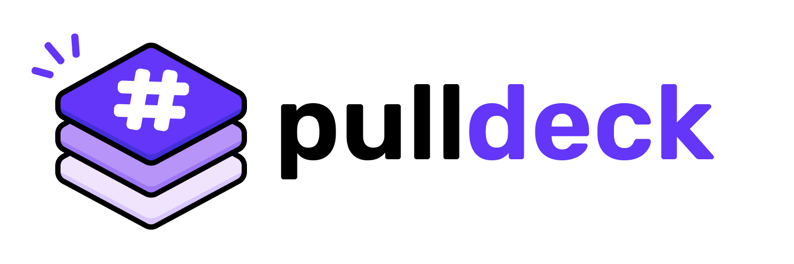

<p align="center">
  
</p>

Browser extension that gives ChatGPT and Claude the GitHub context their
native integrations leave out: commit history, PR discussions, issue
threads, plus reusable Bundles, tagged with `#`.

## Packages

- `extension/` — the MV3 browser extension (Vite + CRXJS)
- `server/` — GitHub App auth server (Cloudflare Worker)

## Build order

1. ChatGPT + Claude adapters, file tagging only
2. GitHub App setup + PR/issue tagging
3. Sensitive file guard
4. Bundles
5. Gemini adapter
6. Commit digest, chat↔code bridge, staleness flags

## Dev

```
pnpm install
pnpm dev       # builds the extension in watch mode
```

Load `extension/dist` as an unpacked extension in Chrome
(`chrome://extensions` → enable Developer Mode → "Load unpacked").

The "Connect GitHub" flow needs `extension/.env` filled in (copy
`extension/.env.example`) with the shared secret and URL of a deployed
`server/` Worker — see `server/README.md` for deploying that first.
